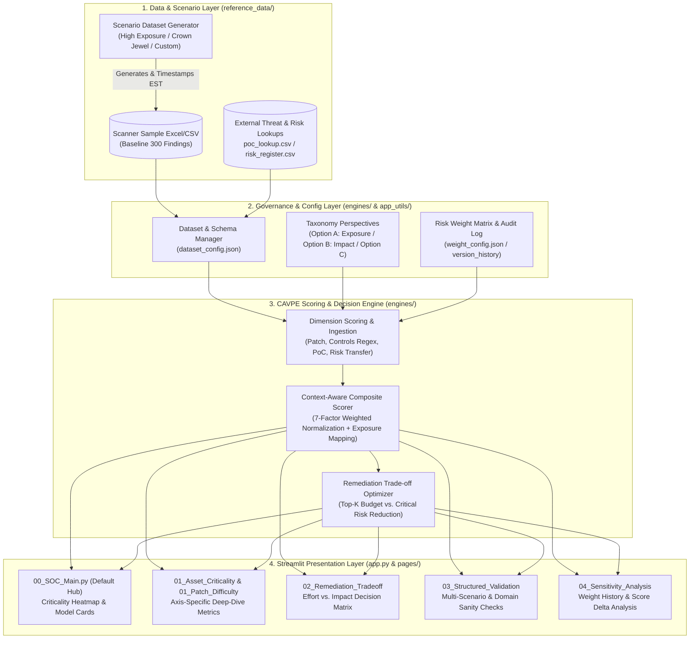

# CAVPE — Context-Aware Vulnerability Prioritization Engine

**CAVPE (Context-Aware Vulnerability Prioritization Engine)** is an interactive cybersecurity decision-support platform built with Python and Streamlit. Rather than relying solely on static CVSS severity scores, CAVPE contextualizes technical vulnerabilities against **asset criticality**, **network exposure**, **active threat intelligence (PoC & wild exploitation)**, **compensating controls**, **remediation effort**, and **risk transfer status**.

---

## Key Features

### 1. Unified SOC Main Hub (`00_SOC_Main.py`)
* **Executive Risk Overview:** Displays real-time posture metrics, Criticality Density heatmaps (`Exposure vs. Asset Group`), and quick-navigation diagnostic cards for **Asset Criticality** and **Patch Difficulty**.
* **Remediation Synthesis Banner:** Quantifies exact risk reduction achieved by patching the top-ranked findings (e.g., Top 10% findings vs. exposed Critical Assets).

### 2. Multi-Dimensional Risk Scoring Engine (`engines/`)
* **7-Factor Weighted Model:** Combines `severity`, `exploited_in_the_wild`, `poc_exploit_availability`, `patch_difficulty`, `compensating_controls`, `asset_criticality`, and `risk_transfer`.
* **Perspective-Driven Taxonomies (`taxonomy_option_*.json`):** Supports switching between **Option A (Exposure-Centric)**, **Option B (Business Impact-Centric)**, and **Option C (Balanced)** exposure classification mappings without modifying core code.
* **Regex Control & Lookup Ingestion:** Parses unstructured compensating control text (`WAF`, `IPS`, `MFA`, `SIEM/EDR`) and integrates external `poc_lookup.csv` and `risk_register.csv` feeds.

### 3. Governance, Versioning & Audit Trail (`app_utils/` & `engines/*.json`)
* **Schema Enforcement:** Validates all uploaded or switched datasets against a strict 21-column schema (`REQUIRED_COLUMNS`).
* **Automated Version History & Attribution:** Tracks dataset switches (`dataset_config.json`) and weight tuning revisions (`weight_config.json` `version_history`) with semantic version bumps, `America/Toronto` (EST/EDT) timestamps, operator names, and client IP detection.

### 4. Structured Validation & Sensitivity Analysis (`03_Structured_Validation.py`, `04_Sensitivity_Analysis.py`)
* **Multi-Scenario Comparison:** Evaluates how the engine adapts Top-10% priorities across **Baseline**, **High Exposure**, **Crown Jewel**, and **Custom** environments generated via the **Scenario Dataset Generator**.
* **Domain Sanity & Baseline Benchmarking:** Verifies alignment with SOC analyst intuition and measures Critical/Internet-facing asset protection gains over a traditional **CVSS-Only** baseline.
* **Historical Weight Sensitivity:** Compares logged weight revisions (`version_history`) using **Spearman Rank Stability** and vulnerability-level **Score Delta** distributions.

---

## System Architecture



---

## Project Structure

```text
CAVPE/
├── app.py                              # Main Streamlit entry point & st.navigation router
├── app_utils/
│   └── config_manager.py               # Portable path resolution, schema validation & dataset versioning
├── engines/
│   ├── dimension_scoring.py            # Core dimension normalization, regex controls & lookup ingestion
│   ├── dataset_config.json             # Active dataset pointer & version history
│   ├── weight_config.json              # 7-factor weights, presets, author/IP audit & version_history
│   ├── taxonomy_option_a.json          # Option A: Traditional Exposure-Centric taxonomy
│   ├── taxonomy_option_b.json          # Option B: Business Impact-Centric taxonomy
│   └── taxonomy_option_c.json          # Option C: Balanced perspective taxonomy
├── pages/
│   ├── 00_SOC_Main.py                  # Executive SOC dashboard hub (default landing page)
│   ├── 01_Asset_Criticality.py         # Impact axis deep-dive analysis
│   ├── 01_Patch_Difficulty.py          # Effort axis & quick-win remediation analysis
│   ├── 02_Remediation_Tradeoff.py      # Impact vs. Effort trade-off optimization
│   ├── 03_Structured_Validation.py     # Multi-scenario comparison & domain alignment validation
│   └── 04_Sensitivity_Analysis.py      # Weight config history comparison & Score Delta analysis
├── reference_data/
│   ├── vulnerability_contextualization_scanner_sample_updated.xlsx
│   ├── poc_lookup.csv                  # CVE-to-PoC maturity lookup table
│   └── risk_register.csv               # Risk acceptance/transfer status register
└── requirements.txt                    # Python dependencies
```

---

## Quick Start

### 1. Prerequisites
* Python **3.10+** (tested on Python 3.11–3.14)
* Recommended packages: `streamlit`, `pandas`, `numpy`, `plotly`, `scipy`, `openpyxl`, `tzdata`

### 2. Installation
```bash
git clone <your-repository-url>
cd CIS-6560-02
pip install -r requirements.txt
```

### 3. Run the Application
```bash
streamlit run app.py
```

---

## Author & Course Context
* **Course:** CIS6560 — Cybersecurity Project
* **Lead Developer:** Myunghee Jung
